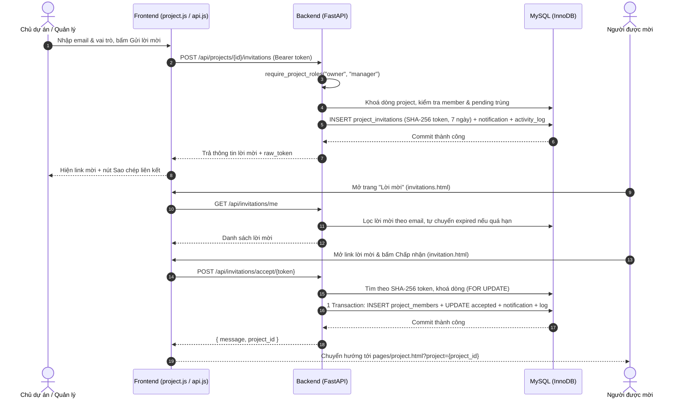

# Luồng hoạt động chức năng: Mời thành viên & Chấp nhận tham gia dự án

Tài liệu này mô tả chi tiết luồng chạy end-to-end từ **Frontend → API → Backend → Database** của tính năng mời thành viên tham gia dự án trong `Agile-Task-Management`.

---

## Sơ đồ tổng quan



---

## Giai đoạn 1: Chủ dự án / Quản lý gửi lời mời

### 1. Thao tác trên giao diện Frontend
- **File**: `frontend/js/pages/project.js` (`#invite-form`)
- `owner` hoặc `manager` mở hộp thoại quản lý thành viên trên trang bảng dự án (`frontend/pages/project.html`), nhập `invitee_email` và chọn `role` (`member`, `viewer`, hoặc `manager` nếu là `owner`).
- Frontend gọi:
  ```js
  api.post(`/projects/${projectId}/invitations`, { invitee_email, role })
  ```

### 2. Tầng gọi API & Tự động làm mới Token
- **File**: `frontend/js/api.js` (`http.interceptors.request` & `http.interceptors.response`)
- Request interceptor tự động lấy `access_token` (hoặc `token`) từ `localStorage` và gắn header `Authorization: Bearer <access_token>`.
- Nếu server trả về `401` (access token hết hạn), response interceptor tự gọi `POST /api/auth/refresh` bằng `refresh_token`, lưu cặp token mới rồi gửi lại request ban đầu.

### 3. Kiểm tra quyền ở Router Backend
- **File**: `backend/app/routers/invitations.py` (`create_invitation`)
- Route `POST /api/projects/{project_id}/invitations` dùng dependency `require_project_roles("owner", "manager")` để đảm bảo:
  - Người gọi đã đăng nhập và tài khoản còn `is_active = True`.
  - Dự án tồn tại, chưa xóa mềm (`deleted_at IS NULL`) và đang `active`.
  - Người gọi có vai trò `owner` hoặc `manager` trong dự án.

### 4. Xử lý nghiệp vụ & Ràng buộc Database
- **File**: `backend/app/crud/project.py` (`create_project_invitation`)
- **Database**: `backend/sql/init.sql` (bảng `project_invitations`, `project_members`, `notifications`, `activity_logs`)
- Các bước thực thi:
  1. Nếu người mời là `manager` mà chọn vai trò `manager` → trả `403 Forbidden`.
  2. Chuẩn hóa email về chữ thường (`strip().lower()`).
  3. Khóa dòng `projects` bằng `with_for_update()` để tuần tự hóa các request mời đồng thời.
  4. Kiểm tra bảng `project_members`: nếu email đã thuộc dự án → trả `400 Bad Request` (`"Người dùng này đã là thành viên của dự án"`).
  5. Kiểm tra lời mời `pending` trùng:
     - Nếu còn hạn (`expires_at > now`) → trả `400 Bad Request`.
     - Nếu đã quá hạn (`expires_at <= now`) → tự cập nhật thành `expired` rồi `db.flush()`.
     - Ràng buộc DB `uq_invitations_pending` trên `(project_id, pending_email)` chặn tuyệt đối 2 dòng `pending` trùng ở tầng MySQL.
  6. Sinh cặp token qua `generate_invitation_token_pair()`:
     - `raw_token`: chuỗi ngẫu nhiên an toàn (`secrets.token_urlsafe(32)`) trả về cho client tạo link mời.
     - `token_hash`: mã băm SHA-256 (64 ký tự hex) lưu vào cột `token` (`CHAR(64) UNIQUE`) trong bảng `project_invitations`.
  7. Đặt `status = "pending"`, `expires_at = now + 7 ngày`.
  8. Nếu email đã có tài khoản trong `users`, tạo thêm bản ghi `notifications` (`type = "invitation_sent"`) và ghi `activity_logs`, sau đó `db.commit()`.

### 5. Hiển thị kết quả trên Frontend
- Frontend nhận `invitation.raw_token`, tạo đường dẫn `pages/invitation.html?token=<raw_token>` kèm nút **Sao chép liên kết** và tải lại danh sách lời mời đang chờ.

---

## Giai đoạn 2: Người được mời xem & phản hồi lời mời

### 6. Xem danh sách "Lời mời của tôi"
- **File**: `frontend/pages/invitations.html`, `frontend/js/pages/invitations.js`
- **Backend**: `backend/app/routers/invitations_public.py` (`list_my_invitations`)
- Frontend gọi `GET /api/invitations/me`.
- Backend lọc các lời mời có `LOWER(invitee_email) == current_user.email.lower()` thuộc các dự án chưa bị xóa mềm; những lời mời `pending` đã quá hạn sẽ tự được chuyển sang `expired`.
- Với lời mời đang `pending`, giao diện hiển thị nút **Phản hồi lời mời** dẫn tới `pages/invitation.html?token=...`.

### 7. Chấp nhận hoặc Từ chối lời mời
- **File**: `frontend/pages/invitation.html`, `frontend/js/pages/invitation.js`
- **Backend**: `backend/app/routers/invitations_public.py` (`accept_invitation`, `decline_invitation`)

#### Khi bấm **Chấp nhận** (`POST /api/invitations/accept/{token}`):
1. `find_invitation_by_token()` băm token đầu vào bằng SHA-256 để tra cứu cột `token` (có hỗ trợ fallback khi truyền trực tiếp hash 64 ký tự từ danh sách `/invitations/me`).
2. Khóa dòng lời mời bằng `with_for_update()` để tránh bấm chấp nhận 2 lần đồng thời.
3. Kiểm tra lần lượt:
   - Tồn tại lời mời (`404` nếu không có).
   - `status == "pending"` (`400` nếu đã xử lý).
   - Chưa quá hạn `expires_at` (nếu quá hạn → cập nhật `status = "expired"`, `db.commit()` và trả `400`).
   - Dự án còn tồn tại và đang `active` (`400`/`404` nếu không).
   - Đúng email người được mời: `invitation.invitee_email.lower() == current_user.email.lower()` (`403` nếu sai tài khoản).
   - Chưa phải là thành viên trong `project_members`.
4. **Trong cùng 1 transaction**:
   - Thêm dòng vào `project_members` với `role = invitation.role`.
   - Cập nhật `invitation.status = "accepted"`, `invitee_id = current_user.id`, `responded_at = now`.
   - Tạo thông báo `invitation_accepted` gửi cho người mời (`inviter_id`) và ghi `activity_logs` (`action = "joined"`).
   - `db.commit()` (nếu phát sinh `IntegrityError` → `db.rollback()` toàn bộ).
5. Trả về `{"message": "Đã chấp nhận lời mời tham gia dự án", "project_id": invitation.project_id}`.
6. Frontend hiện thông báo và chuyển hướng sang `pages/project.html?project=<project_id>`.

#### Khi bấm **Từ chối** (`POST /api/invitations/decline/{token}`):
- Kiểm tra tương tự (tồn tại, `pending`, chưa hết hạn, đúng email).
- Đổi `invitation.status = "declined"`, lưu `responded_at`, gửi thông báo `invitation_declined` cho người mời, `db.commit()`.
- Frontend chuyển người dùng về lại trang `pages/invitations.html`.
